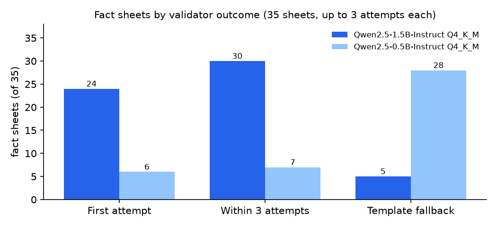
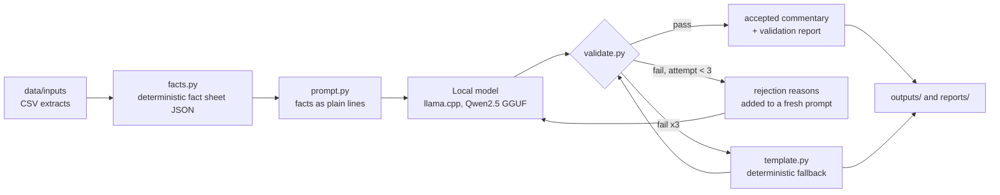

# Local-LLM variance commentary with a fact checker

[](https://github.com/amirator/llm-variance-commentary-local/actions/workflows/ci.yml)

A small open-source model, running on CPU, writes the short paragraph that usually sits above a variance table ("Q3 POS spending rose 8.5% year on year, led by…"). Every draft goes through a rule-based checker before it is accepted. The checker compares each number with a deterministic fact sheet and also checks direction words, the named line items, and any causes or outlooks the facts don't support. Drafts that fail get up to two retries, and if all three attempts fail the pipeline falls back to a plain template. Every accepted paragraph is therefore either model text that passed the checker or template text. Passing the checker does not mean the text is correct, and the manual review below shows how often it isn't.

The inputs are real figures from three of my earlier public projects: Saudi point-of-sale spending (SAMA), Costco's 10-K figures from SEC EDGAR, and the City of Los Angeles General Fund ledger. The repo includes every draft, every rejection reason, and an honest error count, which counts the mistakes the checker missed as well as the ones it caught.

Author: **Amir Khan**

## The problem

Commentary is the slowest part of a month-end or quarterly pack, and it is where wrong numbers slip in. Language models write fluent commentary but invent figures, flip "up" and "down", and add causes nobody gave them ("driven by strong consumer demand"). This repo tests one narrow question: with a free 1.5-billion-parameter model on an 8-thread CPU, how much commentary can be drafted automatically if nothing goes out unchecked, and what does the checker still miss?

## Results (35 fact sheets, real data)

| Model (GGUF, Q4_K_M) | First attempt passes the checker | Passes within 3 attempts | Falls back to template | Mean seconds per attempt (8 CPU threads) |
|---|---|---|---|---|
| Qwen2.5-1.5B-Instruct | **24/35 (69%)** | **30/35 (86%)** | 5/35 (14%) | 15.4 |
| Qwen2.5-0.5B-Instruct | 6/35 (17%) | 7/35 (20%) | 28/35 (80%) | 6.3 |



The full tables are in [`reports/eval_table.md`](reports/eval_table.md), broken down by source and by rejection reason. Every draft for every sheet, with the checker's verdict on each attempt, is in [`outputs/`](outputs/). A full run took about 13 minutes for the 1.5B model and 10 minutes for the 0.5B model (the 0.5B model is faster per attempt but needs more of them).

**What the checker caught (1.5B model).** It made 52 attempts, 30 of which were accepted. The 22 rejected attempts had these issues (an attempt can have several):
- 14 added interpretation or causes ("financial health", "liquidity", "efficiency", "e-commerce") or used "previous quarter" on year-on-year data.
- 7 had a number that is not in the facts, e.g. "SAR 1,563 billion" when the fact is in millions.
- 7 described a decrease as an increase or the other way round.
- 2 missed a required driver and 2 were too long.

The five sheets that ended on the template for the 1.5B model were Costco FY2022, FY2023 and FY2025 and SAMA 2023Q2 and 2023Q3.

**What the checker missed (manual review, [`reports/manual_review.md`](reports/manual_review.md)).** I read every accepted model draft against its fact sheet and wrote down a verdict for each.
- **1.5B model:** 12 of the 30 accepted drafts contain a factual error. Seven attach a real number to the wrong line item or measure (for example, a prior-year sector value presented as the current one, or the LA Liability Claims change quoted as −7.4%, which is the Non-Departmental General figure). Five say something the sheet contradicts, such as "the decrease is attributed to Human Resources Benefits, which increased by $13.6 million". Another 4 drafts have correct numbers but add wording the facts don't support ("reflecting a strong performance"), and 14 are clean.
- **0.5B model:** all 7 accepted drafts contain an error.
- **Net result:** for the 1.5B model, 18 of 35 sheets (51%) got model-written commentary without a factual error (14 clean, 4 with only unsupported wording). Another 5 sheets used the template, and 12 contain an error that the checker missed and a human would have to catch. The review involves judgement, and a few calls are marked as borderline in the file.
- The heuristic in `scripts/audit_attribution.py` flagged 16 numbers across 8 of the 1.5B drafts. Reading confirmed errors in 6 of those 8 drafts and found 6 more drafts with errors that it had not flagged, so it is a lead and not a substitute for reading.

**Checker stress test.** I took the 37 drafts that passed (30 from the 1.5B model, 7 from the 0.5B model) and applied five kinds of synthetic error, following the rule-based corruption idea in FactCC: a hallucinated number, a flipped direction word, an invented sector or department, an added cause or outlook, and a dropped required driver. The checker caught all of them for four of the five error kinds (37 of 37 each) and 34 of 36 (94%) flipped directions ([`reports/validator_stress_test.json`](reports/validator_stress_test.json)). One draft had no direction word to flip, which is why that row has 36 cases. These rates only cover errors the checker was built for. The manual review above shows the errors it was not built for.

## Data

| Source | Original publisher | What is used | Taken from |
|---|---|---|---|
| Point of Sale Transactions by Sector and City | Saudi Central Bank (SAMA), republished by [KAPSARC](https://datasource.kapsarc.org/explore/dataset/point-of-sale-transactions-by-sector-and-city/) | Weekly POS value and transactions by sector, May 2020 – Jul 2025, rolled up to the average weekly value per calendar quarter. 16 quarters compared year on year (2021Q3–2025Q2). | [ksa-pos-spending-dashboard](https://github.com/amirator/ksa-pos-spending-dashboard) |
| SEC EDGAR XBRL Company Facts, CIK 0000909832 | U.S. SEC ([API](https://data.sec.gov/api/xbrl/companyfacts/CIK0000909832.json)) | Costco 10-K revenue, SG&A, operating income, net income, operating cash flow and capex. 5 fiscal years compared year on year (FY2022–FY2026). | [costco-3-statement-dcf-sec](https://github.com/amirator/costco-3-statement-dcf-sec) |
| City Expenditures by Month ([`3ctd-sjrm`](https://controllerdata.lacity.org/d/3ctd-sjrm)) and City Budget and Expenditures ([`uyzw-yi8n`](https://controllerdata.lacity.org/d/uyzw-yi8n)) | Los Angeles City Controller | General Fund postings by department. 12 months compared year on year (Jul 2025 – Jun 2026), plus FY2025 and FY2026 budget vs actual. | [la-city-month-end-close-bva](https://github.com/amirator/la-city-month-end-close-bva) |

`data/inputs/` holds small extracts so the repo runs on its own, and `manifest.json` records their row counts and SHA-256. `python -m vcomm.prepare` rebuilds them from local copies of the three source repos (see the docstring in `src/vcomm/prepare.py`).

## How it works



1. **Fact sheets** (`src/vcomm/facts.py` → `data/factsheets/*.json`). Each fact sheet holds the headline, the comparison values, and up to five of the largest movers (three for the budget-vs-actual sheets). Every fact has a raw value, a unit class (money, %, pp, count, currency) and the exact display string the model is told to copy. The sheets are deterministic, and CI fails if a rebuild changes them.
2. **Drafting** (`src/vcomm/generate.py`). The model runs through `llama-cpp-python` with temperature 0.3, top-p 0.9, at most 320 tokens and seed 7 + attempt number. The prompt contains only the fact sheet and the rules.
3. **Checking** (`src/vcomm/validate.py`). The checker reports these issue types:
   - `unsupported_number`: the value isn't in the sheet within rounding tolerance;
   - `unit_mismatch`: % vs pp, or bn vs mn;
   - `wrong_currency`;
   - `unsupported_period`;
   - `wrong_direction`: up/down words next to a number or a named driver;
   - `missing_headline` and `missing_driver`;
   - `unsupported_entity`: a sector, department or company that isn't in the sheet;
   - `unsupported_claim`: causes, macro talk, forecasts, quarter-on-quarter wording on year-on-year data, and interpretation such as "efficiency" or "financial health";
   - `format`: length, markdown, leaked keys.
4. **Retry and fallback** (`src/vcomm/pipeline.py`). Each retry is a fresh prompt that lists the rejection reasons. After three failures, the template is used, and it passes the same checker.
5. **Evaluation** (`src/vcomm/evaluate.py`, `src/vcomm/mutate.py`, `scripts/make_report.py`, `scripts/audit_attribution.py`). The evaluation covers pass rates, rejection reasons, the mutation stress test, and a heuristic audit that flags numbers which may be attached to the wrong line item, for manual review.

## Models

| | Qwen2.5-1.5B-Instruct | Qwen2.5-0.5B-Instruct |
|---|---|---|
| File | `qwen2.5-1.5b-instruct-q4_k_m.gguf` | `qwen2.5-0.5b-instruct-q4_k_m.gguf` |
| Source | [Qwen/Qwen2.5-1.5B-Instruct-GGUF](https://huggingface.co/Qwen/Qwen2.5-1.5B-Instruct-GGUF) | [Qwen/Qwen2.5-0.5B-Instruct-GGUF](https://huggingface.co/Qwen/Qwen2.5-0.5B-Instruct-GGUF) |
| Quantisation | Q4_K_M (llama.cpp k-quant, 4-bit) | Q4_K_M |
| Licence | Apache-2.0 | Apache-2.0 |
| SHA-256 | `6a1a2eb6…e434e9407e` | `74a4da8c…e7b93d7a9db` |

`scripts/download_models.sh` downloads both files and checks the full hashes. The results above come from llama-cpp-python 0.3.36 (prebuilt CPU wheel) on an 8-thread Linux CPU with no GPU.

## How to run

```bash
pip install -r requirements.txt          # pandas, pytest
python -m pytest -q                      # 36 tests + 1 expected failure (documented gap)
python run.py facts                      # rebuild data/factsheets/
python run.py stub                       # full pipeline with the stub generator (no model)

# local model run
pip install -r requirements-llm.txt --extra-index-url https://abetlen.github.io/llama-cpp-python/whl/cpu
bash scripts/download_models.sh          # ~1.6 GB into models/
python run.py eval --model models/qwen2.5-1.5b-instruct-q4_k_m.gguf --model models/qwen2.5-0.5b-instruct-q4_k_m.gguf
python scripts/make_report.py            # reports/eval_table.md + eval_chart.png
python scripts/audit_attribution.py      # leads for manual review
python scripts/build_manual_review.py    # renders reports/manual_review.md from my verdicts
```

**CI** (GitHub Actions, Python 3.11 and 3.12) runs the tests, rebuilds the fact sheets and checks that they haven't changed, and runs the whole pipeline with a **stub generator** that returns fixed text. CI never downloads or runs a model. The model results in this README come from the local run that is committed in `outputs/` and `reports/`.

## Tests

`tests/test_validator.py` covers the checker on hand-made drafts. These include adversarial edits: a wrong number, transposed digits, flipped directions, % vs pp, wrong currency, a wrong period, an invented sector, forecasts, "previous quarter" on year-on-year data, interpretation words, a dropped driver, markdown and leaked keys. Rounded figures are tolerated. It also includes regression cases for false alarms found during the run ("General Fund" read as a department, "the decrease in operating cash flow"). One `xfail` test documents a known gap: a sector name outside the lexicon is not caught. `tests/test_pipeline.py` covers the retry, feedback and fallback logic and the stress test, and `tests/test_facts.py` checks the fact sheets against figures in the source projects.

## Limitations

- **Attribution isn't checked.** The checker confirms that a number exists in the sheet, not that it belongs to the line item or year it is attached to. That is the main remaining error type: 7 of the 12 drafts with errors among the 30 accepted 1.5B drafts attach a real number to the wrong item, and 5 more misattribute a direction or definition. `scripts/audit_attribution.py` flags likely cases, but it is a heuristic that both raises false alarms and misses real errors, so a human still reviews the text.
- **Rules, not understanding.** The causal and interpretation filters are phrase lists. Wording such as "reflecting a strong performance" or "the spending habits of consumers" can get through, and an odd but number-correct sentence ("the decrease is attributed to X, which increased") is not flagged (it happened in 3 of the 30 accepted 1.5B drafts).
- **Entity lexicon.** Invented names are caught only if they are in the lexicon of known sectors, departments and companies (see the `xfail` test).
- **Small sample.** There are 35 sheets from three sources, and each model run is one seeded pass, so the rates will move with other seeds, prompts or quantisations.
- **No external context.** Like the fact sheets, the commentary describes what changed, not why. Causes have to come from the business.

## Repo layout

```
data/inputs/        CSV extracts + manifest (sha256)
data/factsheets/    35 deterministic fact sheets (JSON)
src/vcomm/          facts, prompt, generate, validate, template, pipeline, evaluate, mutate, prepare
outputs/<model>/    every draft, attempt and validation report (JSON) + readable .md per sheet
reports/            eval_table.md, eval_chart.png, summaries, stress test, manual_review.md/.json
scripts/            download_models.sh, make_report.py, audit_attribution.py, build_manual_review.py
tests/              pytest suite
```

References: [REFERENCES.md](REFERENCES.md). License: [MIT](LICENSE).
